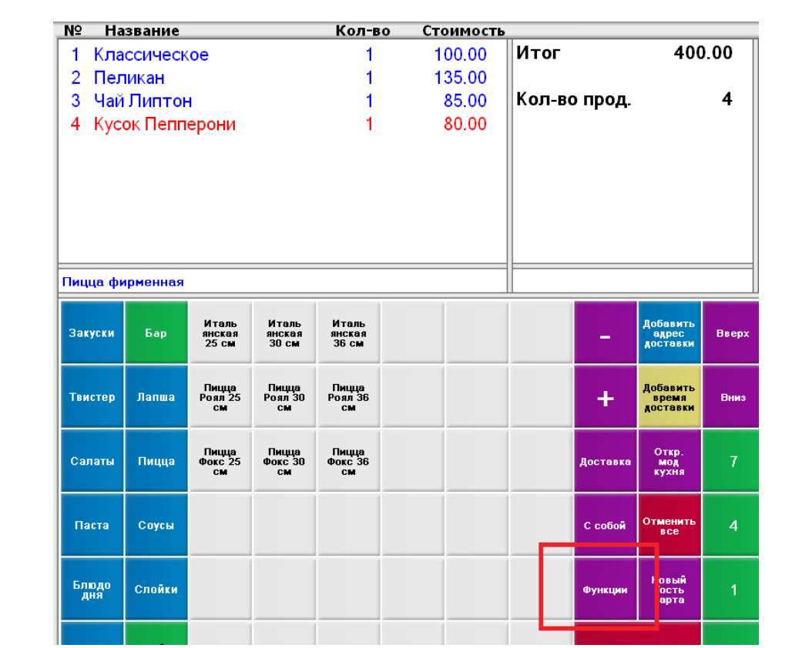
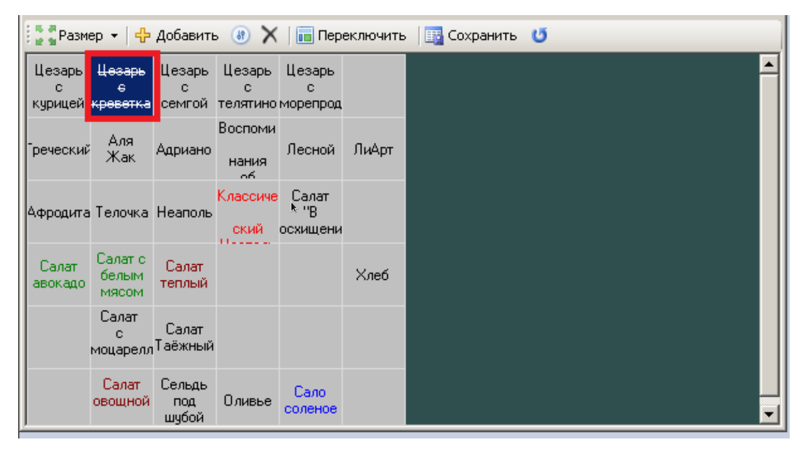
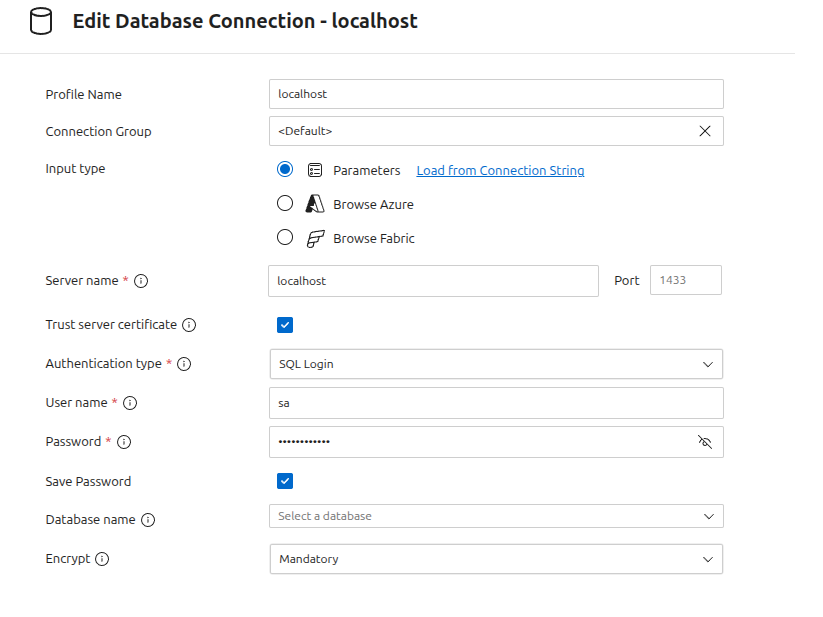
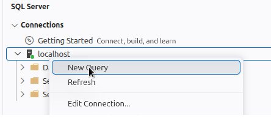
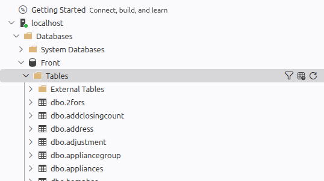

# Техническое задание

> После долгой подготовки к собеседованию, изучения и тренировке, Вы сумели устроится в крупную ИТ компанию **"ООО Ромашка"** в проект импортозамещения. Вы полны решимости доказать себе и Вашим коллегам свою квалификацию. Вас включили в проект миграции старой структуры в новую базу данных (OLAP).

## Легенда
Компания "ООО Ромашка" занимается разработкой программного обеспечения для автоматизации: `кафе`, `баров` и `ресторанов`. Так же в компании есть решения для мелкой розничной торговли. В компании есть собственный флагманский продукт `Front`. Данная система имеет очень гибкую структуру которая позволяет настраивать программное обеспечение под любые требования малого и среднего бизнеса. Клиент может самостоятельно настраивать интерфейс, вести учет продукции, выполнять основные кассовые операции и вести учет согласно требования локации. Данный продукт инсталлирован в различных регионах: `Европа`, `Азия`, `Россия`.

Основной системы `Front` является СУБД - [MS SQL Server](https://en.wikipedia.org/wiki/Microsoft_SQL_Server). Продукт от компании **Microsoft**. Особенность данной СУБД является:
- `Низкая стоимость` (версия [Express](https://www.microsoft.com/en-us/download/details.aspx?id=108838))
- `Высокая производительность` (выпуск [Enterprise](https://learn.microsoft.com/ru-ru/sql/sql-server/editions-and-components-of-sql-server-2022?view=sql-server-ver17))

Компания "ООО Ромашка" приняло решение о миграции на другой тип СУБД: `PostgreSQL`. Так же в рамках данного проекта принято решение **разделить** устаревшую структуру текущей базы данных системы `Front` на две отдельные базы данных: [OLTP, OLAP](https://aws.amazon.com/ru/compare/the-difference-between-olap-and-oltp/)

База данных для системы `Front` развивалось на протяжении **15 лет**. Первый опытный продукт был создан в **1998 году** и внедрен в `Канаде`
Описание текущей структуры **утеряно**. Развивать систему сложно ввиду высоких затрат на техническое обслуживание.

## Описание
Основной особенностью системы `Front` является пользовательская настройка каталога продуктов. В системе есть справочник номенклатуры и связка между карточкой номенклатуры с пользовательской настройкой (кнопкой). 
Пример:


Таким образом в системе можно создавать единый каталог продукции (номенклатура) и разные варианты меню:
- Сезонный вариант (летнее меню, новодний праздник и прочее)
- Пользовательский вариант (бизнес-ланч, корпоратив)

Так же в системе имеются разные варианты цен. Типы цен назначаются в отдельном справочнике и устанавливаются через отдельную систему управления. Для одного и того же продукта могут быть разные закупочные и розничные цены. Например: цена напитка при продаже (Coca cola) может отличатся в зависимости от варианта меню.

В системе предусмотрен вариант временного отключения продажи на часть продукции. Например, если завершились товарные запасы.

Пример настройки пользовательского интерфейса.


## Требования
В рамках миграции необходимо **изучить** текущую структуру и выполнить первичную миграцию для анализа исторических данных по направлениям:

1. Анализ закупки продукции. Шаг `Месяц`.
2. Анализ продажи товара. Шаг `Месяц`
3. Анализ взаимоотношений с поставщиками. Шаг `Месяц`
4. Анализ работы персонала. Щаг `Полгода, Квартал`
5. Анализ остатков. Шаг `Одна неделя`

Реализовать [ABC-анализ](https://ru.wikipedia.org/wiki/ABC-%D0%B0%D0%BD%D0%B0%D0%BB%D0%B8%D0%B7)
Для выполнения анализа 


### Подготовка
1. Запустите [`docker compose`](./../../_Infra/docker-compose.yaml) и скачайте MSSQL Server 2027.
```sh
sudo docker compose up -d
```

**Внимание!** Проверьте наличие файла `.env` и все требуемые ключи.
При успешном запуске Вы должны получить следующее:

```sh
sudo docker ps -a
CONTAINER ID   IMAGE                                        COMMAND                  CREATED          STATUS          PORTS                                              NAMES
735b75cecf4d   dpage/pgadmin4                               "/entrypoint.sh"         26 minutes ago   Up 26 minutes   443/tcp, 0.0.0.0:5050->80/tcp, [::]:5050->80/tcp   pgadmin
b54b5799dbf0   postgres:16.3                                "docker-entrypoint.s…"   26 minutes ago   Up 26 minutes   0.0.0.0:15435->5432/tcp, [::]:15435->5432/tcp      postgres
609821c0e315   mcr.microsoft.com/mssql/server:2017-latest   "/opt/mssql/bin/nonr…"   26 minutes ago   Up 26 minutes   0.0.0.0:1433->1433/tcp, [::]:1433->1433/tcp        mssql2017
```

2. Установите в `Visual Studio Code` расширение https://marketplace.visualstudio.com/items?itemName=ms-mssql.mssql
и подключите СУБД:<br>


**Внимание!** Пароль для доступа к MSSQL указывается в файле `.env`, ключ: `MSSQL_PASS`
Типовой набор ключей:
```sh
PGADMIN_PORT=5050
PGADMIN_PASSWORD=123456
PGADMIN_EMAIL="postgress@yandex.ru"
POSTGRES_LOGIN=postgres
POSTGRES_PASSWORD=postgres
MSSQL_PASS=Irkutsk2020!
```

3. Скачайте бэкап базы данных: https://disk.yandex.ru/d/eNryHf6r-ncJdA
и положите в каталог [backup](./../../_Infra/backup/).

4. Откройте новый SQL Query и перенесите в скрипт из файла [restore.sql](./../../restore.sql). Далее, выполните скрипт. При успешном выполнении, добавиться новая база данных.

|                 |                         |
|-----------------|-------------------------|
|     |             |


